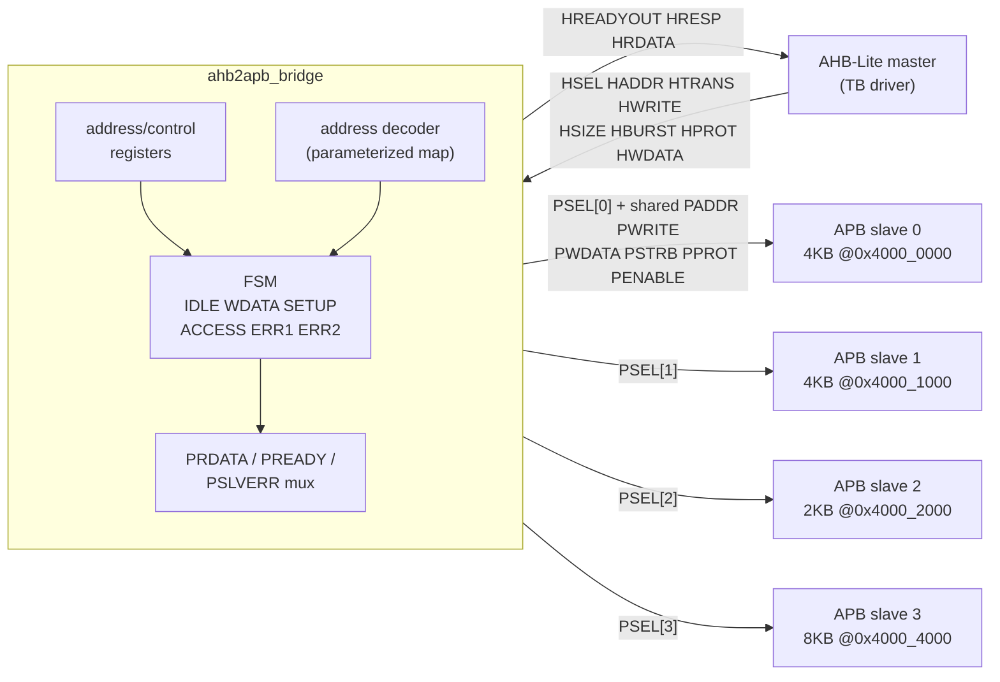
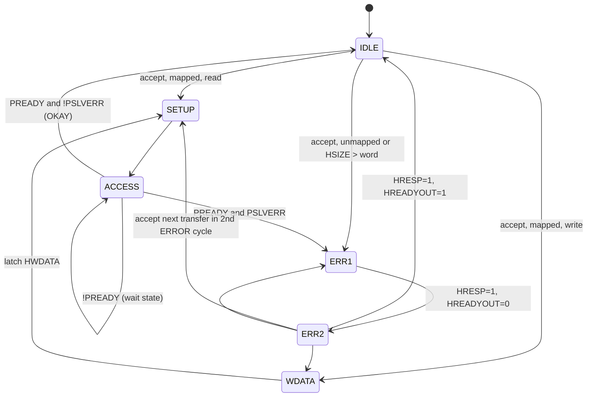
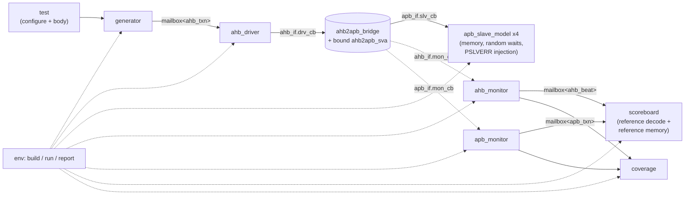

# AHB-Lite to APB4 bridge: RTL and class-based verification

An AHB-Lite slave to APB4 master bridge with a 4-slave address decoder, verified by an
object-oriented, class-based SystemVerilog testbench. The testbench has a UVM-style
structure but uses plain SystemVerilog, with no UVM library. It includes a generator,
a driver, monitors, reactive APB slave models, a scoreboard with a reference model,
functional coverage, and protocol assertions attached with `bind`.

Everything here compiles, simulates and passes on **Verilator 5.054** (with z3 as the
constraint solver). The results below come from the generated files in
[`docs/results/`](docs/results/). They are produced by `make results` and none were
edited by hand.

| | |
|---|---|
| Regression | **55/55 runs pass**: 10 tests × 5–10 seeds, **160,952 AHB beats checked** by the scoreboard, 0 mismatches, 0 assertion failures |
| Functional coverage | **118/118 covergroup bins (100%)**, **34/34 assertion cover properties hit** |
| RTL code coverage | line 100%, branch 100%, expression 100%, toggle 100% (2 documented exclusions) |
| Assertions | 29 labeled concurrent assertions, each paired with a cover property, plus 5 cover-only sequences |
| Bug injection | **4/4 injected RTL bugs detected** ([details](docs/results/bug_injection.md)) |

---

## Contents

1. [Design](#1-design)
2. [Testbench architecture](#2-testbench-architecture)
3. [How to run](#3-how-to-run)
4. [Tests](#4-tests)
5. [Assertions](#5-assertions)
6. [Results](#6-results)
7. [Bug injection](#7-bug-injection)
8. [Debugging](#8-debugging)
9. [Limitations](#9-limitations)
10. [References](#10-references)

Repository layout:

```
rtl/ahb2apb_bridge.sv          the bridge (synthesizable style, lint-clean with verilator -Wall)
tb/pkg/ahb2apb_cfg_pkg.sv      address map, AHB encodings, reference helper functions
tb/if/                         ahb_if, apb_if (clocking blocks + modports), rst_if
tb/sva/ahb2apb_sva.sv          bound assertion module;  ahb2apb_sva_pkg.sv: failure bookkeeping
tb/classes/                    ahb2apb_pkg: txn, generator, driver, slave model, monitors,
                               scoreboard, coverage, env
tb/tests/                      base_test, directed tests, random tests, +TEST factory
tb/top/tb_top.sv               clock, reset, interfaces, DUT, test selection, VCD dump
scripts/regress.py             parallel regression + coverage merge and report
scripts/bug_inject.py          INJECT_BUG_<n> campaign
scripts/vcd_table.py           cycle-by-cycle text view of a VCD (used in docs/debug_log.md)
docs/verification_plan.md      features -> tests -> assertions -> coverage traceability
docs/debug_log.md              bugs found and how they were fixed
docs/results/                  generated regression, coverage and bug-injection results
```

---

## 1. Design

### Block diagram



### Address map (parameters `SLV_BASE` / `SLV_SIZE`)

| Slave | Range | Size |
|---|---|---|
| S0 | 0x4000_0000 – 0x4000_0FFF | 4 KB |
| S1 | 0x4000_1000 – 0x4000_1FFF | 4 KB |
| S2 | 0x4000_2000 – 0x4000_27FF | 2 KB |
| **hole** | 0x4000_2800 – 0x4000_3FFF | unmapped |
| S3 | 0x4000_4000 – 0x4000_5FFF | 8 KB |
| everything else | | unmapped → AHB ERROR, no APB transfer |

### Bridge FSM



`accept = HSEL & HREADY & HTRANS[1] & HREADYOUT`. IDLE and BUSY transfers are never
accepted, so they get the zero-wait OKAY response the spec requires.

### Key design decisions (and why)

1. **Fully registered AHB response.** HREADYOUT, HRESP and HRDATA are flops. There is
   no combinational path from PREADY or PSLVERR back to the AHB bus, which keeps the
   AHB timing path short. The cost is one extra cycle per transfer: reads complete
   with 2 wait states and writes with 3, plus any PREADY waits.
2. **A WDATA state for writes.** AHB write data arrives in the cycle *after* the address
   phase, but APB needs PWDATA valid in SETUP. The bridge spends one cycle latching
   HWDATA, so PWDATA is a flop and is stable for the whole APB transfer.
3. **The address register loads only on `accept`.** The AHB master puts the *next*
   address on HADDR while the current transfer is still running. Loading PADDR on
   anything else would corrupt it (this is injected bug 1).
4. **The ERROR response falls out of the FSM.** ERR1 and ERR2 are states, so the
   two-cycle response is structurally guaranteed. ERR2 also accepts the next transfer,
   because the second ERROR cycle is the last cycle of that data phase.
5. **Each beat becomes one APB transfer, and HBURST is ignored.** AHB gives the address
   of every beat, so bursts (including WRAP) need no special logic. The 1 KB rule
   guarantees that a burst never crosses from one slave into another.
6. **Decode before starting APB.** Unmapped addresses (and HSIZE wider than the bus) go
   straight to ERR1 with no PSEL. This is checked by `ah_unmapped_no_psel`.
7. **PPROT = {~HPROT[0], 0, HPROT[1]}**, giving {instruction, non-secure, privileged}.
   AHB-Lite has no security attribute, so transfers are marked secure.
   **PSTRB** comes from HSIZE and HADDR[1:0] for writes, and is 0 for reads.

### Timing (from a real run, unedited `scripts/vcd_table.py` output)

Each row shows the values in the cycle that ends at that clock edge. `state_q`:
0 IDLE, 1 WDATA, 2 SETUP, 3 ACCESS, 4 ERR1, 5 ERR2. `HTRANS` 2 = NONSEQ.

**A write to 0x4000_0000 immediately followed by a read of the same address**
(`single_rw`, seed 1):

```
$ python3 scripts/vcd_table.py waves/single_rw_1.vcd --from 105 --to 175 \
    --signals state_q,HTRANS,HADDR,HWRITE,HWDATA,HREADYOUT,HRDATA,PSEL,PENABLE,PADDR,PWDATA,PREADY
   t(ns)    state_q     HTRANS      HADDR     HWRITE     HWDATA  HREADYOUT     HRDATA       PSEL    PENABLE      PADDR     PWDATA     PREADY
     105          0          2   40000000          1   57ac4486          1   a055aa10          0          0   40000010          0          0
     115          1          2   40000000          0   2f15ba77          0   a055aa10          0          0   40000000          0          0
     125          2          2   40000000          0   2f15ba77          0   a055aa10          1          0   40000000   2f15ba77          0
     135          3          2   40000000          0   2f15ba77          0   a055aa10          1          1   40000000   2f15ba77          1
     145          0          2   40000000          0   2f15ba77          1   a055aa10          0          0   40000000   2f15ba77          0
     155          2          2   40000ffc          1   f87b0230          0   a055aa10          1          0   40000000   2f15ba77          0
     165          3          2   40000ffc          1   f87b0230          0   a055aa10          1          1   40000000   2f15ba77          1
     175          0          2   40000ffc          1   f87b0230          1   2f15ba77          0          0   40000000   2f15ba77          0
```

- **105:** the write's address phase is accepted (HREADYOUT=1). HWDATA is still junk
  (the driver deliberately drives random data outside write data phases).
- **115:** WDATA state. HWDATA=0x2f15ba77 is valid, and the master has *already*
  pipelined the read's address phase (HWRITE=0) onto the bus. HREADYOUT=0 stalls it.
- **125 / 135:** APB SETUP then ACCESS with PREADY=1. PADDR and PWDATA are stable.
- **145:** the write completes OKAY (HREADYOUT=1), and in the same cycle the read's
  address phase is accepted. The master moves on to the next address (0x4000_0ffc).
- **155–175:** SETUP, ACCESS, then HRDATA=0x2f15ba77, the data just written.

**Five PREADY wait states** (`wait_states`, seed 1, write to 0x4000_0280): ACCESS
(state 3) lasts 6 cycles while PADDR stays fixed and HREADYOUT stays low.

```
$ python3 scripts/vcd_table.py waves/wait_states_1.vcd --from 6215 --to 6305 \
    --signals state_q,HTRANS,HADDR,HWRITE,HREADYOUT,PSEL,PENABLE,PADDR,PREADY
   t(ns)    state_q     HTRANS      HADDR     HWRITE  HREADYOUT       PSEL    PENABLE      PADDR     PREADY
    6215          0          2   40000280          1          1          0          0   40004262          0
    6225          1          0   40000280          1          0          0          0   40000280          0
    6235          2          0   40000280          1          0          1          0   40000280          0
    6245          3          0   40000280          1          0          1          1   40000280          0
    6255          3          0   40000280          1          0          1          1   40000280          0
    6265          3          0   40000280          1          0          1          1   40000280          0
    6275          3          0   40000280          1          0          1          1   40000280          0
    6285          3          0   40000280          1          0          1          1   40000280          0
    6295          3          0   40000280          1          0          1          1   40000280          1
    6305          0          0   40000280          1          1          0          0   40000280          0
```

To reproduce: `make waves TEST=<test> SEED=1`, then run the command shown.

---

## 2. Testbench architecture



| Component | File | What it does |
|---|---|---|
| `ahb_txn` | `ahb_txn.svh` | rand addr, write, size, burst, beats, data[], HPROT, target region. Constraints: HSIZE alignment, beat count per HBURST, **1 KB boundary** for INCR bursts, wrap addressing (`addr_of()`), weighted `dist` over in-map/out-of-map targets and burst types. `copy()`, `compare()`, `convert2string()`. |
| `generator` | `generator.svh` | directed helpers (`single`, `burst`, `burst_wr_rd`) and `random(n)`, sending through a bounded mailbox |
| `ahb_driver` | `ahb_driver.svh` | pipelined AHB-Lite master: address phase of beat k together with HWDATA of beat k−1; changes signals only after HREADY; random IDLE gaps and BUSY cycles; cancels the burst after the first ERROR cycle (configurable %) |
| `apb_slave_model` | `apb_slave_model.svh` | one per PSEL bit: memory-backed, random PREADY waits (min..max), random or address-targeted PSLVERR, protocol self-checks, memory cleared on reset |
| `ahb_monitor` / `apb_monitor` | `*_monitor.svh` | passive, clocking-block based; rebuild beats and transfers, sample coverage, send to the scoreboard |
| `scoreboard` | `scoreboard.svh` | predicts for every AHB beat: APB transfer yes/no, PSEL, PADDR, PWRITE, PWDATA, PSTRB, PPROT, HRESP, and read data from a reference memory. Prints `time, field, address, expected vs actual` on any mismatch. |
| `coverage` | `coverage.svh` | `cg_ahb` (burst × size, rw × region, back-to-back, error cause, BUSY, unmapped zone), `cg_apb` (PSEL × rw, waits × rw, PSLVERR), `cg_reset` |
| `env` | `env.svh` | builds and connects everything; `run()`, `wait_idle()`, `apply_reset()`, `report()` with the pass/fail criteria |

A run **passes** only if all of these hold: no scoreboard mismatch, no assertion failure,
no APB protocol error seen by the slave models, no randomization failure, at least one
beat checked, no unmatched APB transfer, and the beat accounting adds up (generated =
accepted + cancelled + dropped by reset; driver completed = monitor beats = scoreboard
checks).

---

## 3. How to run

Prerequisites (tested on macOS with Homebrew Verilator 5.054, z3 5.4.1 and Surfer 0.7.0. Covergroups need Verilator 5.050 or later):

```bash
brew install verilator z3 surfer
```

| Command | What it does |
|---|---|
| `make compile` | build `build/default/Vtb_top` |
| `make run TEST=burst_all SEED=3` | run one test; log in `logs/default_burst_all_3.log` |
| `make run TEST=random_regress SEED=7 NUM_TXNS=5000` | longer random run |
| `make run TEST=single_rw PLUSARGS=+VERBOSE` | print every transaction |
| `make regress` | every test with several seeds in parallel, with a summary table |
| `make cov` | regression, then merge coverage and print the coverage report |
| `make waves TEST=slave_error SEED=1` | dump `waves/slave_error_1.vcd` and open it in Surfer |
| `make bugs` | bug-injection campaign |
| `make run BUG=3 TEST=slave_error` | run one test against injected bug 3 |
| `make results` | regress + coverage + bugs; rewrites `docs/results/*.md` |
| `make lint` | `verilator --lint-only -Wall` on the RTL (clean and all 4 bug variants) |
| `make clean` | remove build outputs, logs, coverage and waves |

Runtime plusargs: `+TEST=<name> +SEED=<n> +NUM_TXNS=<n> +WAVES +VERBOSE +TIMEOUT=<cycles>`.

---

## 4. Tests

| Test | Kind | What it covers |
|---|---|---|
| `single_rw` | directed | SINGLE write/read to each slave at its first and last word; byte and halfword lanes; reads of unwritten words |
| `burst_all` | directed | every burst type (SINGLE, INCR, INCR4/8/16, WRAP4/8/16) × every size, written then read back; WRAP bursts that actually wrap; INCR16 ending exactly on a 1 KB boundary |
| `wait_states` | directed | the same traffic with 0, 1 and 5 PREADY wait states, then a mixed per-slave profile |
| `slave_error` | directed | PSLVERR on reads and writes; mid-burst error with master cancel and continue; error with wait states; back-to-back errors; an errored write leaves memory unchanged |
| `decode_error` | directed | out-of-map decode: just outside every region edge, inside the hole, far addresses; boundary words that must hit; bursts into holes; HSIZE > word |
| `back_to_back` | directed | zero-IDLE streams of reads and writes, read-after-write to the same address, back-to-back bursts |
| `busy_burst` | directed | BUSY cycles in the middle of every burst type, and BUSY together with a mid-burst ERROR |
| `reset_mid` | directed | reset in the middle of an APB wait state, an ERROR response, a write data phase, and while idle; full re-check after each |
| `random_regress` | constrained random | 2,000 transactions per seed: random targets (5% unmapped), bursts, sizes, 0..5 waits, 5% PSLVERR, BUSY, IDLE gaps, cancel-on-error |
| `random_stress` | constrained random | 1,000 transactions per seed, back to back, no waits: maximum pipeline pressure |

The feature-to-test traceability is in [`docs/verification_plan.md`](docs/verification_plan.md).

---

## 5. Assertions

All 29 assertions are in `tb/sva/ahb2apb_sva.sv`. They are attached with
`bind ahb2apb_bridge ahb2apb_sva ... (.*)`, which also passes the instance's address map.
Each `<label>` also has a `cov_<label>` cover property.

| Label | Rule |
|---|---|
| `ap_psel_onehot0` | at most one PSEL bit high |
| `ap_setup_then_access` | SETUP is followed by ACCESS on the same slave |
| `ap_first_cycle_setup` | the first PSEL cycle has PENABLE = 0 |
| `ap_penable_only_access` | PENABLE implies PSEL |
| `ap_access_held_in_wait` | PENABLE && !PREADY → still in ACCESS next cycle |
| `ap_penable_drop_after_rdy` | PENABLE && PREADY → PENABLE low next cycle |
| `ap_stable_paddr` / `_pwrite` / `_psel` / `_pprot` / `_pstrb` / `_pwdata` | stable from SETUP through every wait state (PENABLE && !PREADY) |
| `ap_pstrb_zero_on_read` | PSTRB = 0 for reads |
| `ap_psel_matches_map` | PSEL equals an **independent** reference decode of PADDR |
| `ah_unmapped_no_psel` | an out-of-map (or illegal-size) transfer never asserts PSEL |
| `ah_unmapped_error` | ... and starts an ERROR response in its first data-phase cycle |
| `ah_read_to_setup` / `ah_write_to_setup` | a mapped read reaches SETUP 1 cycle later, a write 2 cycles later (transfer sequencing) |
| `ah_stall_during_apb` | HREADYOUT is low while any PSEL is high |
| `ah_okay_after_apb` / `ah_slverr_to_error` | APB completion → OKAY, or PSLVERR → ERROR |
| `ah_hrdata_from_prdata` | HRDATA equals the PRDATA of the completing read |
| `ah_idle_busy_okay` | IDLE, BUSY or unselected → zero-wait OKAY |
| `ah_error_two_cycle` | HRESP=1 & HREADYOUT=0 → next cycle HRESP=1 & HREADYOUT=1 |
| `ah_error_second_has_first` | the second ERROR cycle is always preceded by the first |
| `ah_addr_ctrl_stable_wait` | master side: HADDR and control stable while HREADY is low (except an IDLE cancel after ERROR) |
| `ah_hwdata_stable_wait` | master side: HWDATA stable during a stalled write data phase |
| `ar_reset_values` | during reset: HREADYOUT=1, HRESP=0, PSEL=0, PENABLE=0 |
| `ar_no_x_ctrl` | no X/Z on control outputs after reset (meaningful only on a 4-state simulator, see [Limitations](#9-limitations)) |

Cover-only: `cov_apb_wait_5` (5 consecutive wait cycles), `cov_decode_err_seq`,
`cov_slverr_seq`, `cov_b2b_ahb`, `cov_reset_in_apb`.

A failing assertion calls `ahb2apb_sva_pkg::fail(<label>)`, which prints the label with
the time and counts it. The run continues, so it reports every failing property, and
the test fails at the end.

---

## 6. Results

Generated on 2026-11-25 with Verilator 5.054. Full tables:
[`docs/results/regression_summary.md`](docs/results/regression_summary.md) and
[`docs/results/coverage_summary.md`](docs/results/coverage_summary.md).

### Regression (`make regress`)

| Test | Seeds | Pass | Fail | Beats checked | SB mismatches | SVA failures |
|---|---|---|---|---|---|---|
| single_rw | 1–5 | 5 | 0 | 300 | 0 | 0 |
| burst_all | 1–5 | 5 | 0 | 2,190 | 0 | 0 |
| wait_states | 1–5 | 5 | 0 | 1,440 | 0 | 0 |
| slave_error | 1–5 | 5 | 0 | 160 | 0 | 0 |
| decode_error | 1–5 | 5 | 0 | 280 | 0 | 0 |
| back_to_back | 1–5 | 5 | 0 | 400 | 0 | 0 |
| busy_burst | 1–5 | 5 | 0 | 1,255 | 0 | 0 |
| reset_mid | 1–5 | 5 | 0 | 335 | 0 | 0 |
| random_regress | 1–10 | 10 | 0 | 120,383 | 0 | 0 |
| random_stress | 1–5 | 5 | 0 | 34,209 | 0 | 0 |
| **Total** | | **55** | **0** | **160,952** | **0** | **0** |

The whole regression takes about 33 s of wall time with 10 parallel jobs on an Apple M5.

### Coverage (`make cov`, merged over all 55 runs)

| Metric | Result |
|---|---|
| Covergroup bins, all (`cg_ahb`, `cg_apb`, `cg_reset`) | 118/118 = 100% |
| • `x_burst_size` (8 burst types × 3 sizes) | 24/24 |
| • `x_rw_region` (read/write × 4 slaves + unmapped) | 10/10 |
| • `x_waits_rw` (0, 1, 2, 3–4, 5+ waits × read/write) | 10/10 |
| • `x_psel_err` (4 slaves × OKAY/PSLVERR) | 8/8 |
| • `cp_err_cause` (none, decode, PSLVERR, illegal size) | 4/4 |
| • `cg_reset` (reset while idle / AHB pending / APB in flight) | 3/3 |
| Assertion cover properties hit | 34/34 |
| RTL line / branch / expression / toggle | 16/16, 24/24, 36/36, 964/964 (100% each) |

Exclusions from code coverage, marked in the RTL with `/* verilator coverage_off */`
and a justification: the unreachable FSM `default` branch, and the `unused_ok` lint
tie-off. A single random run reaches 98.21% of `cg_ahb`. The missing bin is the
illegal-size error cause, which only the directed `decode_error` test produces, so the
merge of directed and random runs is what closes coverage.

---

## 7. Bug injection

`make bugs` rebuilds the RTL with `+define+INJECT_BUG_<n>` and runs the 8 directed
tests plus `random_regress` (seed 1) against each bug. Results come from
[`docs/results/bug_injection.md`](docs/results/bug_injection.md):

| Bug | What is wrong in the RTL | Tests failing | Caught by assertions | Caught by scoreboard |
|---|---|---|---|---|
| 1 | PADDR register enable lacks HREADY qualification, so **PADDR changes during the transfer** | 9/9 | `ap_stable_paddr`, `ap_psel_matches_map` | PADDR, HRDATA |
| 2 | PENABLE = SETUP \|\| ACCESS: **PENABLE asserted in the same cycle as PSEL** | 9/9 | `ap_first_cycle_setup`, `ah_read_to_setup`, `ah_write_to_setup` | NO_SETUP (plus the APB slave model's protocol check) |
| 3 | ERR1 → IDLE with HRESP=0: **second ERROR cycle missing**, so the master sees OKAY | 4/9 (every test that produces errors) | `ah_error_two_cycle` | HRESP |
| 4 | Slave 2 decoded with slave 1's size: **wrong PSEL decode** for 0x4000_2800–0x4000_2FFF | 2/9 (`decode_error`, `random_regress`) | `ah_unmapped_no_psel`, `ap_psel_matches_map`, `ah_unmapped_error` | UNEXPECTED_APB, HRESP |

Every bug is caught by both an assertion and the scoreboard. Bug 4 shows why both
directed and random tests matter: only the directed boundary test and a full-length
random run reach the affected 2 KB window. A 300-transaction random run missed it
(see [debug log](docs/debug_log.md#6-a-short-random-run-missed-injected-bug-4-verification-gap)).

---

## 8. Debugging

[`docs/debug_log.md`](docs/debug_log.md) records each real problem found during bring-up,
with the symptom, the root cause and the fix. Waveforms (VCD dumps from `+WAVES`) were
analyzed with `scripts/vcd_table.py`, which prints the per-cycle signal values the log
quotes. The same VCDs open in Surfer with `make waves`. In summary:

- **Testbench bug:** the power-on reset produced no negedge, so the asynchronous reset
  never fired before the first clock. Found by `ar_reset_values`.
- **Test bug:** `busy_burst` targeted addresses past the end of the 2 KB slave. Found
  from unexpected decode-error counts and a 75% `cp_psel`.
- **Testbench accounting bug:** BUSY slots cancelled after an ERROR were miscounted.
- **Coverage-model and measurement fixes:** reset coverage was sampling the power-on
  reset, and Verilator didn't attribute line hits to `return` statements inside a `case`.
- **Verification gap:** a short random run missed bug 4, so a coverpoint was added.
- **Waveform analysis of each injected bug** (bugs 1 and 3 with cycle tables).

The delivered RTL itself has not failed a check since it was written. The bugs above were
in the verification environment, and Part 2 of the log shows the environment catching
realistic RTL bugs.

---

## 9. Limitations

- **2-state simulation.** Verilator is mostly a 2-state simulator, so `ar_no_x_ctrl`
  (`$isunknown`) cannot fail here. Instead, every run uses `--x-initial unique`,
  `--x-assign unique` and `+verilator+rand+reset+2`, so uninitialized state is
  randomized per seed. That is how the reset-modeling bug was found. A 4-state
  simulator (VCS, Xcelium or Questa) would make the X check meaningful. The sources
  are standard SystemVerilog, but they have **not** been run on a commercial simulator.
- **Single AHB slave.** HREADY is tied to the bridge's own HREADYOUT, and HSEL is 1 for
  every transfer. The case where another slave stalls HREADY while the bridge is
  selected is not exercised.
- **Same clock on both sides.** PCLK = HCLK, so there is no clock-domain crossing.
- **Verilator SystemVerilog support.** Covergroups (supported since 5.050) and constrained
  randomization (via z3) worked for everything used here. The workarounds that were
  needed are listed in the debug log: `std::mailbox`, VCD instead of FST, and a counting
  fail action instead of `$error`.
- Synthesis and formal verification were not run. The RTL is written in a synthesizable
  style and is lint-clean with `verilator -Wall`.

---

## 10. References

- ARM IHI 0033A, *AMBA 3 AHB-Lite Protocol Specification*: <https://support.arm.com/documentation/ihi0033/a/>
- ARM IHI 0024C, *AMBA APB Protocol Specification* (APB4: PPROT, PSTRB, PSLVERR, PREADY): <https://support.arm.com/documentation/ihi0024/c/>
- Verilator manual: <https://verilator.org/guide/latest/>
